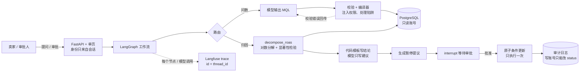

# 跨境卖家经营异常归因与处置 Agent

卖家问"日本店上周广告 ROI 为什么变差了"，Agent 查数、拆解原因、定位到广告组，给出处置建议；需要暂停广告组时，先等有权限的人审批，再执行并写审计日志。

这个项目要证明的不是"能聊天"，而是把 Agent 接到真实业务数据和写操作上时，做到这四件事：

- **结果可校验**：模型不写 SQL，只输出结构化查询（MQL），由编译器确定性地生成 SQL；归因的数字和结论由代码计算，模型只负责理解问题和写建议。
- **有权限边界**：店铺权限在编译层注入每一个子查询，不靠 prompt；数据库账号按最小权限拆分。
- **有失败处理**：校验错误回传给模型自修正；审批幂等，重复点击只执行一次；观测服务挂了不影响主流程。
- **用评测证明效果**：111 道评测题 + 留出集，和 Text-to-SQL、ReAct 两个基线对比，目标事先定好，没达标的也照实写。

> 数据是合成的（3 家店 × 90 天，固定种子生成，埋了 4 类数据陷阱和 6 个已知的 ROI 下滑事件）。

## 快速开始

需要 Docker 和一个 DeepSeek API key（可选：Langfuse Cloud 的 key，用来看 trace）。

```bash
cp .env.example .env          # 填入 DEEPSEEK_API_KEY 等
docker compose up -d --build --wait
```

打开 http://localhost:8000，在页面顶部选一个演示用户开始提问。启动顺序是：数据库健康检查通过 → `seed` 服务生成并导入合成数据（库里已有数据就跳过）→ 前端启动。

> 项目路径含中文等非 ASCII 字符时，`docker compose` 自己构建镜像会失败（BuildKit 的已知问题），先单独构建：`docker build -t adagent-app .`，再 `docker compose up -d --wait`。

本机开发：

```bash
docker compose up -d --wait db
uv run python -m datagen.generate && uv run python -m datagen.load
uv run uvicorn adagent.web.server:app --port 8000
uv run pytest -q                       # 245 个测试，需要数据库
```

演示流程和讲稿见 [docs/demo.md](docs/demo.md)。

## 架构



## 关键设计（每条都有取舍，详见 [SPEC.md](SPEC.md)）

| 设计 | 做法 | 为什么 |
|---|---|---|
| LLM 不写 SQL | 模型只输出 MQL（JSON），Pydantic 校验后由 `adagent/semantic/compiler.py` 编译；MQL 里的值一律参数绑定 | SQL 可校验、可测试；换成更弱的模型也稳（千问下 86.4% vs Text-to-SQL 34.8%） |
| 口径只有一个来源 | 指标定义都在 `catalog.yaml`；模型的 prompt 和基线拿到的口径文档都从它生成 | 改口径只改一处；软删除、多币种、时区、退款滞后这 4 类陷阱由编译器统一处理 |
| 权限在编译层 | 每个读表子查询都带 `shop_id = ANY(%(allowed_shops)s)`，`allowed_shops` 来自服务端权限表；prompt 里不提权限 | 模型不遵守 prompt 也越不了权（越权题 10/10 拦截）；只读账号 + 5 秒超时兜底 |
| 歧义先问 | "销售额""ROI"有多种口径时反问，选项由代码校验，回答映射回候选项 | 猜错口径会给出看起来正确的错误数字 |
| 归因由代码算 | 净 ROAS 对数分解成转化率 / 点击成本 / 客单价 / 退款四个因子，z 检验判断显著性，店铺不显著时下钻广告组（Bonferroni 校正） | 确定性计算可复现；模型只解释，不算数 |
| 结论由模板写 | 结论段由代码按模板生成，不认识的形态直接报错；模型只写"建议和说明"，其中出现结论里没有的数字就重写，再有就丢弃 | 数字和结论不可能被模型编错 |
| 审批幂等 | LangGraph `interrupt` 等待审批（等待节点没有副作用）；执行用 `UPDATE ... WHERE status='pending'` 原子抢占；写账号只能改 `ad_groups.status` | 实测并发两次"批准"都通过了图层面的检查，靠数据库只执行了一次 |
| 身份只来自服务端 | 演示登录写签名 cookie，请求体里的 user_id / approver_id 一律忽略；会话只给发起人和该店铺的审批人 | 前端的检查只为体验，所有判断在服务端 |
| 观测不拖垮主流程 | Langfuse trace id = thread_id = 审计日志 trace_id；埋点出错只记日志 | 从一次暂停能查到当时的完整推理；观测服务挂了，提问照常完成 |

## 评测结果

完整数字、运行记录和每次改题的原因见 [eval/RESULTS.md](eval/RESULTS.md) 和 [eval/CHANGELOG.md](eval/CHANGELOG.md)。标准答案 SQL 独立手写，不经编译器；没有针对某道评测题调 prompt。

### M2 全集正式评测（2026-11-13，目标事先定好）

查询类 76 题 + 歧义 10 题 + 归因 25 题。查询类每题 1 次，temperature 0。基线是 Text-to-SQL：拿到完整 DDL 和口径文档，有同样的自修正机会。

| | 本方案 / DeepSeek | 本方案 / 千问 | Text-to-SQL / DeepSeek | Text-to-SQL / 千问 |
|---|---|---|---|---|
| 查询类准确率 | 62/66（93.9%） | 57/66（86.4%） | **65/66（98.5%）** | 23/66（34.8%） |
| 首次即对 | **62/66（93.9%）** | 53/66（80.3%） | 46/66（69.7%） | 17/66（25.8%） |
| 越权拦截 | 10/10 | 10/10 | 10/10 | 8/10 |
| 平均耗时 / 题 | 2.5 秒 | 3.0 秒 | 8.9 秒 | 15.3 秒 |
| token 入 / 出 | 123k / 16k | 136k / 5k | 218k / 130k | 367k / 44k |

| 归因（25 题，每题 3 次） | 本方案 / DeepSeek | ReAct 基线 / DeepSeek |
|---|---|---|
| pass^3（3 次都对） | **25/25** | 14/25 |
| "无显著下滑"干扰题不硬找原因 | 7/7 | — |

**如实说明：**

- **最终准确率上，DeepSeek 的 Text-to-SQL 基线比本方案高**（98.5% vs 93.9%）。本方案丢的 4 题都是 MQL 当时表达不了的两段时间对比（M3 已补上，见下）。本方案的优势在首次即对（+24 个百分点）、成本（输出 token 约 1/8、耗时约 1/3.5）、弱模型下的稳定性，以及权限不依赖模型。
- **跨模型稳定性目标没有达标**：目标是两个模型相差 ≤ 5 个百分点，实测 7.5。
- ReAct 基线有 9/75 次一条查询都没真正执行，在同一次输出里自己编了"查询结果"再下结论，其中 2 次结论碰巧和真值一致。

### 之后的改进（M3，在修复前就提交的留出集上验证）

| 改动 | 留出集 | 本方案 / DeepSeek | 本方案 / 千问 | Text-to-SQL / DeepSeek | Text-to-SQL / 千问 |
|---|---|---|---|---|---|
| 相对时间由代码换算（"上个月""上上周"） | 25 题 × 1 次 | 23/25 | 24/25 | 25/25 | 8/25 |
| 支持两段时间对比，"对比期必须在本期之前"由代码校验 | 25 题 × 3 次，pass^3 | 25/25 | 25/25 | 24/25 | 3/25 |

"对比期必须在本期之前"这条校验，在千问上拦下了 15 次方向写反的回答：两期数字都对，但给卖家的变化方向是反的。原 76 题上两个模型的差距降到 3.0 个百分点，但那是设计修复时看过的题，不作为达标证据。

### 局限

- 只有一套合成数据，结论不能直接推广到真实店铺。
- 每类 10–26 题，差一题就是几个百分点；查询类每题只跑 1 次。
- **归因解释的 LLM judge 没有通过校准**：三批人工标注 vs judge，R2（是否编造）的 κ 分别是 0.51 / 0.70 / 0.54，误报率都超过事先定的 10%，judge 没有上线。"本方案建议段是否编造"改用人工标注报告：39 条里 1 条，95% 区间 0.1%–13.5%（只有一个标注人，可能偏少）。
- 歧义题和归因题只测了 DeepSeek。
- 演示登录不是认证；Langfuse 用的是 Cloud（数据是合成的），真实业务应自托管。

## 项目结构

| 路径 | 作用 |
|---|---|
| `db/init/` | 建表（含 4 类数据陷阱）和最小权限数据库角色 |
| `datagen/` | 合成数据生成（固定种子，`config.yaml` 里有 6 个埋入事件）、导入、容器用的 `seed` |
| `adagent/semantic/` | 指标目录 `catalog.yaml`、MQL 校验、编译器、执行器 |
| `adagent/nl2mql.py` | 自然语言 → MQL → 查询，带自修正 |
| `adagent/attribution/` | 确定性归因（`decompose.py`）和结论模板（`explain.py`） |
| `adagent/workflow.py` | LangGraph 工作流：路由 → 问数 / 归因 → 解释 → 提议 → 审批 → 执行 |
| `adagent/actions.py` | 唯一的写动作：提议、幂等执行、拒绝 |
| `adagent/clarify.py` | 歧义反问 |
| `adagent/tracing.py` | Langfuse 观测 |
| `adagent/web/` | FastAPI 服务端和单页前端 |
| `eval/` | 评测题、评分器、Text-to-SQL 和 ReAct 基线、运行器、judge 校准 |
| `tests/` | 权限、编译器、评分器、归因、工作流、审批、前端接口、观测的测试 |

## 文档

- [SPEC.md](SPEC.md)：设计规格，每个决定都带日期和理由（第十节是决策记录）。
- [eval/RESULTS.md](eval/RESULTS.md)：所有实测数字和运行记录。
- [eval/CHANGELOG.md](eval/CHANGELOG.md)：评测题和标准答案的每次改动及原因。
- [docs/demo.md](docs/demo.md)：演示流程和讲稿。

技术栈：Python 3.12 · FastAPI · LangGraph（checkpoint 存 PostgreSQL）· PostgreSQL 16 · psycopg · Pydantic · DeepSeek / 千问（OpenAI 兼容接口）· Langfuse · Docker Compose · uv。
